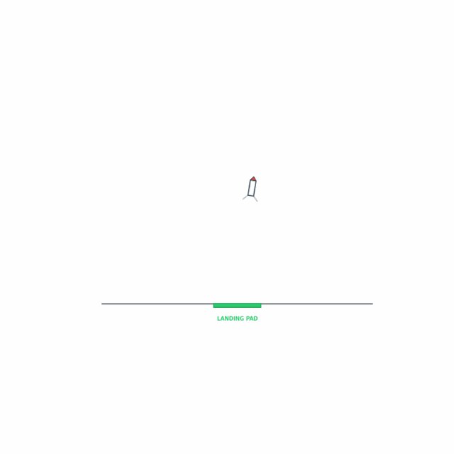

# Rocket Landing RL 🚀

Train a reinforcement-learning agent to land a 2D rocket on a pad — a
from-scratch spinoff built on open-source libraries (Gymnasium +
stable-baselines3). No code is copied from any existing rocket-landing
repo; the environment, physics, and reward shaping are original to this
project. Everything runs fully locally — no API keys, no hosted calls.



## What it is

A 2D rigid-body rocket must descend from a randomised starting position
and land **softly, upright, on the landing pad**. The agent controls a
main engine (off / half / full) plus two side thrusters for attitude
control, with limited fuel. Episodes end on landing, crash, flying
off-screen, or timeout.

## Physics model (`env.py`)

| Quantity | Value |
|---|---|
| Gravity | 9.81 m/s² downward |
| Main thrust (full) | 22 m/s² along the rocket axis (can hover/climb) |
| Side-thruster torque | 6 rad/s² per thruster |
| Linear / angular drag | 0.10 /s, 0.30 /s |
| Fuel | 100 units; main engine 0.18/step at full throttle, RCS 0.03/step each |
| Timestep | 1/60 s, semi-implicit Euler integration |
| Wind | optional constant horizontal acceleration (`--wind`) |

State (8-D): `[x, y, vx, vy, angle, angular_velocity, leg_L, leg_R]`.
Actions (`MultiDiscrete([3, 2, 2])`): main engine off/half/full, left RCS
off/on, right RCS off/on. Ground contact is inelastic: touching down with
the base at y = 0 zeroes velocity. A landing counts when the rocket
touches down **on the pad**, with |vertical speed| ≤ 1.5 m/s,
|horizontal speed| ≤ 1.0 m/s, and |tilt| ≤ 0.20 rad (~11°).

## Reward design

Dense shaping so PPO learns quickly:

- `-0.30 × distance to pad centre` — always pulled toward the pad
- `-0.10 × (|vx| + |vy|)` — slow, controlled descent
- `-0.20 × |angle|` — stay near-vertical
- `-0.01` per step — finish promptly, don't hover forever
- `-0.02 × throttle`, `-0.005` per RCS fire — fuel thrift
- `+0.10 × (1 − |vy|/5)` when low, slow, and over the pad — approach bonus
- **+100** for a clean landing
- **−50 − 10·|vy| − 20·|angle|** for a crash (scales with impact severity)
- **−100** for flying off-screen, **−10** on timeout

## Install

```bash
python3 -m venv .venv && source .venv/bin/activate
pip install -r requirements.txt
```

Requirements: Python 3.10+, CPU-only PyTorch is fine (install via
`pip install torch --index-url https://download.pytorch.org/whl/cpu`
if you want to avoid the large CUDA wheels).

## Train

```bash
python train.py                     # default: 200k timesteps
python train.py --timesteps 500000  # longer run
python train.py --smoke             # quick smoke test (~4k steps)
python train.py --wind 1.5 --out models/windy
python train.py --load models/ppo_rocket.zip --timesteps 100000  # continue
```

Outputs in `models/`: `<name>.zip` (policy), `<name>_curve.csv`
(per-episode reward / length / landed / crashed), `<name>_config.json`.

## Evaluate

```bash
python evaluate.py                                   # 50 episodes
python evaluate.py --episodes 100 --gif runs/my_run.gif --seed 123
```

Prints success rate (landed on pad), crash rate, mean reward, mean fuel
used, mean episode length; saves a GIF of a landing attempt and appends a
JSON-lines summary to `runs/eval_summary.jsonl`.

## Sample results

Results from the actual verified run in this repo (200k-timestep PPO,
50 eval episodes, seed 0) — recorded in `runs/eval_summary.jsonl`:

| Metric | Value |
|---|---|
| Success (landed on pad) | **34/50 = 68.0%** |
| Crashes | 16/50 = 32.0% |
| Mean reward | 37.9 |
| Mean fuel used | 3.7 / 100 |
| Mean episode length | 37 steps |

Training curve (`models/ppo_rocket_curve.csv`) shows the learning clearly:
early episodes average ≈ −120 reward (all crashes); by the end of 200k
steps episodes average ≈ +87 reward (mostly clean landings). A landing
attempt GIF from the eval run is saved at `runs/eval_landing.gif`.

## Final result — 99.7% (Oct 17, 2026)

Continued training from the 200k-step model with `train_until_perfect.py`
(1,000-episode evals per round) reached **99.7% clean landings** and
stopped there as the accepted final result:

| Round | Cumulative steps | Landed / 1000 | Mean reward | Mean fuel |
|---|---|---|---|---|
| 0 | 200,704 | 435 (43.5%) | -18.7 | 3.6 |
| 1 | 600,704 | 897 (89.7%) | 68.6 | 4.7 |
| 3 | 1,400,704 | 984 (98.4%) | 83.3 | 4.3 |
| 4 | 1,800,704 | 991 (99.1%) | 84.5 | 4.3 |
| 6 | 2,600,704 | **997 (99.7%)** | **85.6** | **4.0** |

Best model: `models/ppo_rocket_best.zip` (Round 6). Full per-round logs in
`runs/perfect_run_log.jsonl`.

Note: this final training run used the fixed landing check in `env.py`
— the landing limits (|vy| ≤ 1.5 m/s, |vx| ≤ 1.0 m/s, |tilt| ≤ 0.20 rad)
are now judged on pre-contact impact velocity/tilt, not the post-contact
zeroed state (the original code silently disabled the speed limits).

PPO typically goes from near-0% success (random flailing / crashing) to a
clear majority of clean landings within ~100–200k steps on this task, with
mean fuel use dropping as the policy learns to burn only on final descent.

## Project layout

```
env.py        Gymnasium environment (physics, reward, termination)
render.py     Matplotlib renderer: rocket, flame, pad, trace, telemetry (headless)
train.py      PPO training + per-episode curve logging
evaluate.py   Evaluation + landing GIF
requirements.txt  pinned open-source deps
```

## Ideas for extension

- **Continuous actions** — swap `MultiDiscrete` for a `Box` action space
  (throttle 0–1, torque −1–1) and use SAC instead of PPO.
- **Wind gusts** — time-varying wind instead of a constant value.
- **Moving pad** — a pad that drifts, or a sea-barge that bobs.
- **Curriculum** — start episodes closer to the pad, then widen the spawn.
- **Fuel-optimal landing** — add a landing bonus that scales with fuel left.
- **3D** — extend the state/action space to a full 3D rigid body.
- **Human play mode** — keyboard control (arrow keys) to fly it yourself.
- **Compare algorithms** — benchmark PPO vs A2C vs SAC on the same env.

## License

MIT — use it, fork it, extend it.
